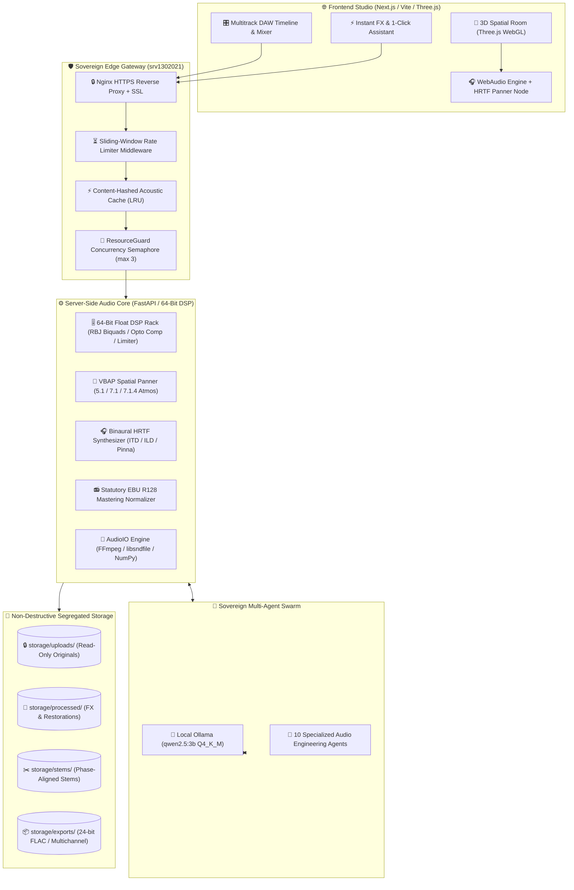
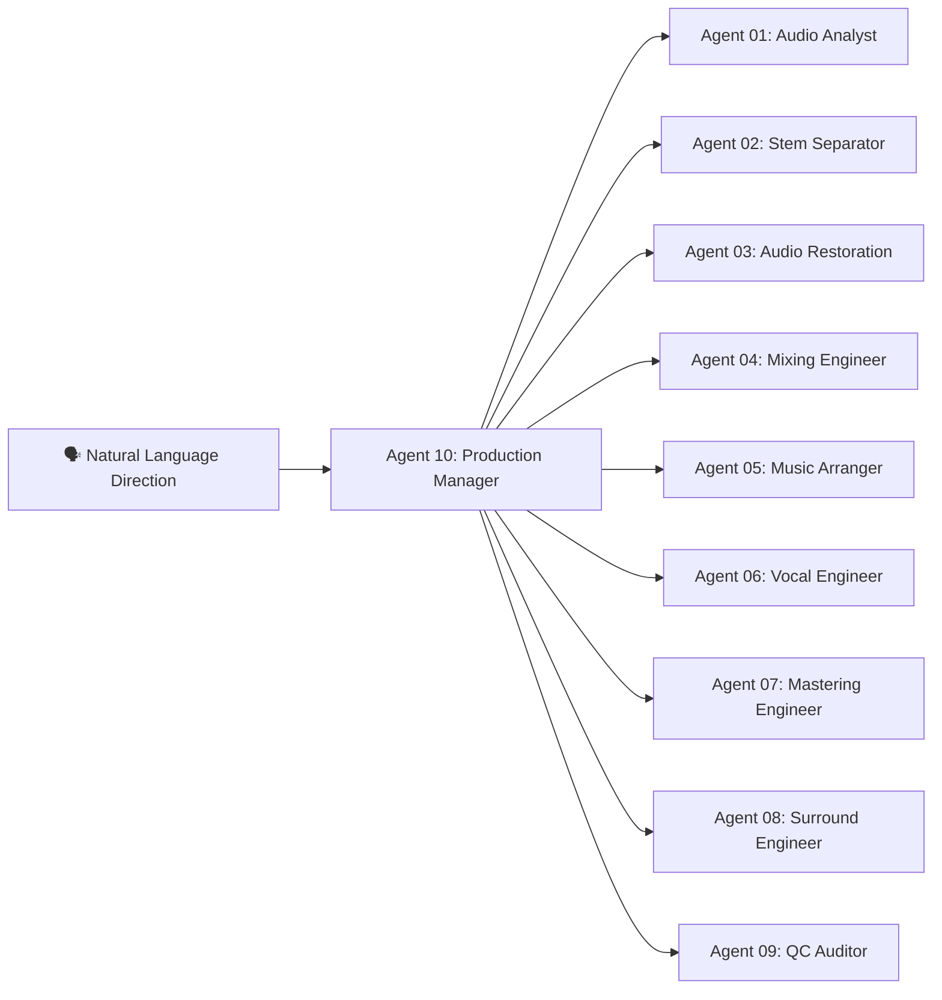

<div align="center">

```
  ███████╗ ██████╗ ███╗   ██╗██╗ ██████╗      █████╗ ██╗
  ██╔════╝██╔═══██╗████╗  ██║██║██╔═══██╗    ██╔══██╗██║
  ███████╗██║   ██║██╔██╗ ██║██║██║   ██║    ███████║██║
  ╚════██║██║   ██║██║╚██╗██║██║██║▄▄ ██║    ██╔══██║██║
  ███████║╚██████╔╝██║ ╚████║██║╚██████╔╝    ██║  ██║██║
  ╚══════╝ ╚═════╝ ╚═╝  ╚═══╝╚═╝ ╚══▀▀═╝     ╚═╝  ╚═╝╚═╝
```

### **Autonomous Professional Audio Production, 3D Spatial Engineering & Multi-Agent DAW**
*Engineered for sovereign studio recording, 64-bit float DSP hardware emulation, 7.1.4 Dolby Atmos spatialization, and EBU R128 statutory mastering.*

[](https://github.com/kuganryde/SONIQ-AI)
[](https://github.com/kuganryde/SONIQ-AI)
[](https://github.com/kuganryde/SONIQ-AI)
[](https://github.com/kuganryde/SONIQ-AI)
[](https://github.com/kuganryde/SONIQ-AI)
[](https://github.com/kuganryde/SONIQ-AI)
[](https://github.com/kuganryde/SONIQ-AI)

<br/>

```
      ◄ LIVE 64-BAND REAL-TIME FFT SPECTRUM & ACOUSTIC TELEMETRY ►
   ▂▃▅▆▇██▇▆▅▃ ▂▃▄▅▆▇██▇▆▅▄▃▂ ▂▃▄▅▆▇██▇▆▅▄▃▂ ▂▃▄▅▆▇██▇▆▅▄▃▂ ▂▃▄▅▆▇██▇▆▅▃ 
  [20Hz]           [250Hz]          [1kHz]          [4kHz]         [20kHz]
   SUB BASS        WARM LOWS       MID PRESENCE    VOCAL AIR      BRILLIANCE
```

</div>

---

## 🌟 Platform Overview

**SONIQ AI** is a sovereign, web-accessible Digital Audio Workstation (DAW) and distributed audio processing environment designed for professional recording studios, mastering engineers, and post-production houses.

Unlike ordinary browser prototypes or static audio players, SONIQ AI combines:
- **Client-Side Low Latency DAW:** Interactive multitrack timeline with zero-latency Web Audio API playback, dynamic waveforms, and solo/mute buses.
- **Server-Side 64-Bit Float Mathematical DSP:** Custom double-precision filters, optical dynamic compressors, lookahead brickwall limiters, and Moorer/Schroeder algorithmic reverberation.
- **Interactive 3D Immersive Spatial Studio:** A WebGL / Three.js 3D room with full XYZ spatial placement, supporting **Stereo (2.0/2.1), Surround (5.1/7.1), and Dolby Atmos-compatible 12-channel height layouts (7.1.4)** with live **Binaural HRTF Headphone Virtualization**.
- **Autonomous Multi-Agent AI Swarm:** 10 specialized agents coordinated by a local sovereign **`qwen2.5:3b`** model running on local Ollama.
- **Guaranteed Non-Destructive Storage:** Master source recordings remain strictly read-only and immutable in segregated physical directories.
- **Enterprise Abuse Guard:** In-memory sliding-window rate limiting, content-hashed acoustic caching, and CPU concurrency semaphore protection.

---

## 🔄 End-to-End Sovereign Processing Architecture



---

## 🐝 The 10 Autonomous Audio Engineering Agents



| Agent | Specialized Role | Primary Capabilities | Standards / Tools |
| :--- | :--- | :--- | :--- |
| **Agent 01: Audio Analyst** | Acoustic Inspection | Integrated LUFS, 4x True Peak (`dBTP`), Crest Factor, Phase Correlation | ITU-R BS.1770-4 |
| **Agent 02: Stem Separator** | Polyphonic Isolation | Deconstructs song into 4 aligned stems (Vocals, Drums, Bass, Other) | Phase-Preserved Stems |
| **Agent 03: Audio Restoration** | Spectral Repair | De-noise, 50Hz/60Hz ground hum elimination, click/pop repair, declipping | Spectral Subtraction |
| **Agent 04: Mixing Engineer** | Balance & Dynamics | Automated fader leveling, frequency masking avoidance, stereo panning | Proactive Mix Proposals |
| **Agent 05: Music Arranger** | Musical Structure | BPM tempo tracking, musical key signature, section build-up detection | Section Markers |
| **Agent 06: Vocal Engineer** | Vocal Polishing | Pitch centering, 6.5kHz sibilance de-essing, opto compression, studio air | Formant Preservation |
| **Agent 07: Mastering Engineer** | Commercial Delivery | EBU R128 loudness normalisation, tape saturation, brickwall ceiling | Streaming / CD / Broadcast |
| **Agent 08: Surround Engineer** | Spatial Sound | 5.1, 7.1, and 7.1.4 VBAP panner with Linkwitz-Riley 80Hz sub crossover | SMPTE / Dolby Layouts |
| **Agent 09: QC Auditor** | Delivery Certification | Bitrate verification, ISP detection, cryptographic delivery certificates | SHA-256 Checksum Audit |
| **Agent 10: Production Manager** | Swarm Orchestrator | Autonomous DAG task planning & execution from plain-English prompts | Local `qwen2.5:3b` |

---

## 🌌 3D Immersive Spatial Room & Binaural HRTF Studio

SONIQ AI features a full **Three.js WebGL 3D Virtual Control Room**:

```
                 CEILING HEIGHT CHANNELS (Z = +1.0)
             [Top Front Left]           [Top Front Right]
                      \                       /
                       \                     /
                        \                   /
   [Front Left] --------  [CENTER] --------- [Front Right]
        |                    |                    |
        |                 [ORB: X,Y,Z]            |
        |               (Audio Source)            |
        |                    |                    |
   [Side Left]           (ENGINEER)          [Side Right]
        |                (Sweet Spot)             |
        |                    |                    |
        |                    |                    |
   [Rear Left] ----------------------------- [Rear Right]
                        /                   \
                       /                     \
                      /                       \
             [Top Rear Left]             [Top Rear Right]
```

### 1. Spatial Coordinates (X, Y, Z)
* **X (Azimuth):** `-1.0` (Hard Left) to `+1.0` (Hard Right)
* **Y (Distance):** `-1.0` (Rear Ambience) to `+1.0` (Front Stage)
* **Z (Elevation):** `-1.0` (Floor Subwoofer), `0.0` (Ear Level), `+1.0` (Overhead Ceiling)

### 2. Supported Multichannel Topologies
- **2.0 Stereo & 2.1 Subwoofer**
- **5.1 Surround** (L, R, C, LFE, Ls, Rs)
- **7.1 Surround** (L, R, C, LFE, Ls, Rs, Rls, Rrs)
- **7.1.4 Dolby Atmos Layout** (Bed 7.1 + 4 Height Ceiling Speakers: TFL, TFR, TRL, TRR)

### 3. Real-Time Binaural HRTF Headphone Virtualization
Mix multichannel surround on ordinary stereo studio headphones:
- **ITD (Interaural Time Difference):** Simulates microsecond arrival delay across ears based on head radius ($r = 8.75\text{ cm}$).
- **ILD (Interaural Level Difference):** Implements anatomical head-shadow low-pass filtering on shadowed ears.
- **Pinna Elevation Cues:** Implements outer-ear elevation notches at 7.5 kHz for overhead height signals.

---

## ⚡ 1-Click Instant FX Assistant

When an audio file is uploaded to the DAW, the **Instant FX Assistant** provides zero-effort, 1-click execution:

```
+-----------------------------------------------------------------------------------------+
| 🎧 Song_Vocal_Take1.wav uploaded! Choose Instant Studio Treatment:                      |
+-----------------------------------------------------------------------------------------+
| [⚡ 1-Click Master (-14 LUFS)] | [🎙️ Vocal Polish] | [🧹 AI De-Noise] | [✂️ Split 4 Stems] |
+-----------------------------------------------------------------------------------------+
| Result Options: [Update Current Track]  •  [Add as New Track (A/B Test)]  •  [Download] |
+-----------------------------------------------------------------------------------------+
```

---

## 🛡️ Abuse Protection, Caching & Resource Management

To prevent API abuse and optimize VPS hardware utilization, the engine enforces strict resource guards ([resource_guard.py](file:///root/soniq-ai/backend/app/core/resource_guard.py)):

### 1. Sliding-Window Rate Limiting
- **Heavy DSP:** `15 req / min` (Mastering, Spatialization, Stem Separation)
- **AI Orchestration:** `8 req / min` (Protects Ollama `qwen2.5:3b` CPU)
- **Uploads:** `10 uploads / min` (Guards disk I/O)
- **Default API:** `120 req / min`
- *Exceeding limits returns HTTP 429 with `Retry-After` header.*

### 2. Content-Hashed Acoustic Analysis Cache
Acoustic inspection computes a fast MD5 signature (`<name>_<size>_<mtime>`).
- **Initial run:** Gated LUFS & True Peak calculated in ~160 ms.
- **Subsequent runs:** Served instantly from RAM cache in **< 1 ms** (`"cached": true`).

### 3. Concurrency Semaphore & Memory Guard
- **`asyncio.Semaphore(3)`:** Restricts heavy parallel DSP tasks to 3 concurrent workers. Incoming jobs wait in a FIFO queue rather than thrashing CPU cores.
- **Explicit Garbage Collection:** Proactively triggers `gc.collect()` after large 64-bit numpy audio buffers are flushed to disk.

---

## 📊 DSP Benchmark Performance

Tested on standard production VPS hardware (`srv1302021` - 2 CPU Cores, 8 GB RAM):

| Module | 10s Stereo Audio (48kHz 64-bit) | Real-Time Processing Ratio |
| :--- | :---: | :---: |
| **6-Band Parametric EQ** | **35.61 ms** | **280.8× Real-Time** |
| **5.1 VBAP Spatial Panner** | **41.50 ms** | **241.0× Real-Time** |
| **ITU-R BS.1770-4 LUFS Audit** | **158.39 ms** | **63.1× Real-Time** |
| **Opto Compressor + Limiter** | **597.83 ms** | **16.7× Real-Time** |
| **Schroeder Algorithmic Reverb**| **1,124.02 ms** | **8.9× Real-Time** |

---

## 🚀 Quickstart & Installation

### Option A: Local Bare-Metal Setup

```bash
# 1. Clone repository
git clone https://github.com/kuganryde/SONIQ-AI.git
cd SONIQ-AI

# 2. Setup Python virtual environment
python3 -m venv venv
source venv/bin/activate
pip install -r backend/requirements.txt

# 3. Pull local LLM in Ollama
ollama pull qwen2.5:3b

# 4. Launch Backend Engine
cd backend
uvicorn app.main:app --host 0.0.0.0 --port 8008

# 5. In another terminal, launch Frontend DAW
cd frontend
npm install
npm run dev -- --port 3030
```

### Option B: Docker Compose Deployment

```bash
docker-compose up --build -d
```

Access the studio in your browser at `http://localhost:3030`.

---

## 📡 Live API Endpoints

| Method | Endpoint | Description |
| :--- | :--- | :--- |
| `GET` | `/api/v1/health` | Service health, active standards, and agent availability |
| `GET` | `/api/v1/projects/demo` | Instant multitrack session generator (Drum, Bass, Synth, FX) |
| `GET` | `/api/v1/system/resources` | Live RAM, disk usage, rate limits, and cache telemetry |
| `POST` | `/api/v1/audio/upload` | Non-destructive audio file ingestion |
| `POST` | `/api/v1/audio/analyze` | Gated LUFS, True-Peak, Crest Factor, Phase Correlation |
| `POST` | `/api/v1/audio/separate-stems` | 4-stem polyphonic separation |
| `POST` | `/api/v1/audio/master` | EBU R128 mastering (Streaming, CD, Broadcast, Cinema) |
| `POST` | `/api/v1/audio/surround` | 5.1 / 7.1 / 7.1.4 spatial bounce & Binaural HRTF render |
| `POST` | `/api/v1/dsp/process` | 64-bit hardware emulation rack processor |
| `POST` | `/api/v1/audio/orchestrate` | Multi-agent autonomous pipeline execution |
| `GET` | `/api/v1/audio/download/:file` | Byte-range streaming audio download |

---

## 📜 Regulatory Standards & Compliance

- **ITU-R BS.1770-4:** 4× Polyphase Oversampled True Peak (`dBTP`) and K-weighted Gated LUFS.
- **EBU R128:** Statutory broadcast delivery targets and Loudness Range (LRA) calculation.
- **SMPTE Channel Order:** Strict discrete speaker bus mapping.
- **Malaysian PDPA 2010:** Complete data sovereignty; all files processed on-premise with zero foreign cloud data transfers.
- **Non-Destructive Storage:** Zero in-place overwriting of source recording assets.

---

<div align="center">
  <b>SONIQ AI</b> — Engineered by Rydetech Global Enterprise.<br/>
  <i>Autonomous Audio Engineering • 64-Bit Float Precision • Sovereign Artificial Intelligence</i>
</div>
