# RYDETECH SONIQ AI — ARCHITECTURAL AUDIT & VYBE AI TRANSFORMATION SPECIFICATION

**Document Version:** 1.0.0-PROD  
**Node Infrastructure:** srv1302021 (Autonomous Sovereign Enclave)  
**Data Residency Compliance:** Malaysian Personal Data Protection Act 2010 (PDPA)  
**Parent Organization:** RYDETECH GLOBAL ENTERPRISE  
**Subsystem Role:** Sovereign Audio Production Subsystem (SONIQ) -> Full Autonomous Media Studio (VYBE)  
**Date of Audit:** 2026-11-23  

---

## 1. Executive Summary

This audit establishes the baseline architectural inventory of **SONIQ AI** and outlines the technical roadmap for evolving the system into **VYBE AI**: an autonomous creative intelligence and professional media production studio combining the speed and automation of CapCut, the multitrack editing precision of Adobe Premiere Pro, the compositing and motion graphics power of Adobe After Effects, and the studio-grade audio mastering of a professional Digital Audio Workstation (DAW).

### Non-Negotiable SONIQ Preservation Mandate
Under strict architectural directives:
- **Zero Rewrites / Zero Deletions:** All existing SONIQ code, endpoints, DSP algorithms, cinema bitstream processors, and database structures remain functional and backward-compatible.
- **SONIQ as Dedicated Audio Subsystem:** SONIQ retains full sovereignty over multitrack audio processing, stem separation, vocal engineering, surround/Atmos/DTS cinema encoding, and broadcast-compliant mastering (EBU R128 / ITU-R BS.1770-4).
- **VYBE as Unified Creative Studio:** VYBE AI builds an overarching multitrack video, timeline, motion graphics, and video rendering architecture that seamlessly drives SONIQ via clean, decoupled, backward-compatible internal interfaces.

---

## 2. Complete Inventory of Existing SONIQ AI Components

### 2.1 Backend Subsystem (FastAPI / Uvicorn / 64-bit DSP)
- **Framework & Runtime:** FastAPI 0.115.0+, Uvicorn 0.30.0+, Python 3.12.3 in isolated virtualenv `/root/soniq-ai/venv`.
- **Process Supervisor:** PM2 process `soniq-backend` (script: `/usr/bin/bash -c "/root/soniq-ai/venv/bin/uvicorn app.main:app --host 0.0.0.0 --port 8008"`), uptime 2D+.
- **Mathematical Precision:** 64-bit IEEE 754 double-precision floating-point DSP array mathematics via NumPy 1.26+ and SciPy 1.14+.
- **Concurrency & Abuse Protection (`app/core/resource_guard.py`):**
  - Semaphore isolation (`max_parallel_heavy_dsp_jobs = 3`) guarding CPU-intensive DSP operations.
  - Multi-tier sliding window rate limiting: Default (60 req/min), Heavy DSP (10 req/min), Upload (20 req/min), AI Orchestrate (5 req/min).
  - High-performance SHA256-keyed LRU Acoustic Analysis Cache (`_analysis_cache`, max capacity 256) preventing redundant FFT and LUFS computations.
  - Automatic 48-hour temporary cache pruning (`prune_temporary_storage`) while guaranteeing immutability of `uploads/`.

### 2.2 Frontend Subsystem (React 18 / Vite / Web Audio API)
- **Framework & Bundler:** React 18.3.1, Vite 5.4.11, Tailwind CSS 3.4.15, Lucide-React icons, Three.js 0.187.0.
- **Process Supervisor:** PM2 process `soniq-frontend` (preview server running on port `3030`), proxied through Nginx.
- **Browser Audio Engine (`frontend/src/audio/WebAudioEngine.js`):**
  - Web Audio API graph (`AudioContext`, `GainNode`, `StereoPannerNode`, `AnalyserNode` with 2048 FFT).
  - Native 3D HRTF Binaural Virtualization Panner (`PannerNode` with HRTF panning model, inverse distance, and listener head-orientation vector tracking).
  - Multitrack synchronized audio streaming and playback buffer management (`Map<trackId, AudioNode>`).
  - Direct microphone capture via `navigator.mediaDevices.getUserMedia` and `MediaRecorder` with floating-point WAV export.
  - Acoustic telemetry and real-time 60fps RTA spectrum and peak/RMS metering.

### 2.3 Core DSP & Cinema Processing Engines
1. **`app/core/audio_io.py`:**
   - Deep inspection via `ffprobe` extracting container metadata, sample rate (up to 192 kHz), bit depth (16, 24, 32f), duration, and channel layouts.
   - Non-destructive 64-bit float NumPy array loader (`load_audio`) with automatic C-level fallback to FFmpeg for exotic compressed codecs.
   - Lossless and uncompressed writer (`write_audio`) for Broadcast WAV, BWF metadata, FLAC, AIFF, and Ogg.
2. **`app/core/dsp_engine.py`:**
   - Robert Bristow-Johnson Audio EQ Cookbook Biquad filter engine (Bell, Low-Shelf, High-Shelf, High-Pass, Low-Pass, Notch).
   - Dynamic VCA and optical compressors with soft-knee logarithmic envelope followers.
   - Zero-overshoot lookahead brickwall peak limiter.
   - Algorithmic Schroeder/Moorer diffusion reverb and stereo ping-pong delay.
   - Hyperbolic tangent (`np.tanh`) analog tape saturation and asymmetric tube saturation.
   - Mid-Side (M/S) stereo width expansion.
3. **`app/core/surround_engine.py`:**
   - Vector-Base Amplitude Panning (VBAP) spatialization across 2.0, 2.1, 5.1, 7.1, and 7.1.4 configurations.
   - 4th-order Linkwitz-Riley 80Hz crossover for dedicated LFE subwoofer channel isolation.
   - ITU-R BS.775 downmix folddown matrix (Surround to Stereo/Mono).
   - Binaural HRTF multichannel downmix convolution for realistic 3D headphone auditioning.
4. **`app/core/cinema_processor.py`:**
   - **Dolby Processor:** Pro Logic II matrix steering, Dialogue Normalization (-31 to -20 dBFS dialnorm), Dolby Dynamic Range Control (DRC film standard / music / speech profiles), Dolby Atmos 7.1.4 height bed synthesis.
   - **DTS Processor:** DTS Neural:X upmixing engine, DTS Dialogue Clarity parametric formant booster.
   - **Cinema Codecs:** Direct streaming bitstream encoders/decoders for certified Dolby AC-3, Dolby Digital Plus E-AC-3, and DTS Coherent Acoustics (DCA).
5. **`app/core/mastering_engine.py`:**
   - ITU-R BS.1770-4 gated K-weighted loudness metering, Loudness Range (LRA), and 4x oversampled inter-sample True-Peak detection.
   - Target profile mastering: Streaming (-14 LUFS, -1.0 dBTP), Club/DJ (-9 LUFS, -0.3 dBTP), Broadcast EBU R128 (-23 LUFS, -1.0 dBTP), Cinema (-27 LUFS, -2.0 dBTP), Audiophile Lossless (-16 LUFS, -1.0 dBTP).
6. **`app/core/synth_engine.py`:**
   - Subtractive dual-oscillator synthesizer (Saw, Square, Triangle, Sine) with Moog-style resonant 24dB low-pass filter and ADSR envelope.
   - 2-Operator Frequency Modulation (FM) synthesizer.
   - Synthetic 808 kick, snare, and percussion generators.
   - MIDI event sequence renderer.
   - Signature RYDETECH Sonic Ident (Sound Logo) brand synthesizer.
7. **`app/core/export_engine.py`:**
   - Lossless multitrack and stereo master export pipeline.
   - Cryptographic SHA256 checksum generation and automated Delivery Quality Certificates.

---

## 3. The 10 Autonomous SONIQ AI Agents

Each agent inherits from `BaseAudioAgent` (`app/agents/base_agent.py`), connects to local Ollama (`qwen2.5:3b` at `http://localhost:11434`), and incorporates a hard-coded deterministic rule-based fallback ensuring zero downtime even under complete LLM unavailability or network partition.

| Agent # | Designation | Core Class | Primary Tools & Operations |
|---|---|---|---|
| **01** | **Audio Analyst** | `AudioAnalystAgent` | `AudioAnalyzer`, `ffprobe`, `SoundFile`, spectral balance, LUFS, True-Peak, DC offset, clipping audit |
| **02** | **Stem Separator** | `StemSeparatorAgent` | Harmonic-Percussive Source Separation (HPSS), median filter masking, Vocals/Drums/Bass/Other |
| **03** | **Audio Restoration** | `AudioRestorationAgent` | Spectral subtraction noise reduction, 50/60Hz notch hum filter, cubic spline declipping |
| **04** | **Mixing Engineer** | `MixingEngineerAgent` | Spectral frequency masking detection, automated gain staging, fader balance, EQ carve recommendations |
| **05** | **Music Arranger** | `MusicArrangerAgent` | Energy onset envelope detection, BPM estimation, musical key classification, structural section segmentation |
| **06** | **Vocal Engineer** | `VocalEngineerAgent` | Pitch correction, dynamic sibilance de-essing (5.5-8.0 kHz), optical vocal compression, 12kHz studio air shelf |
| **07** | **Mastering Engineer** | `MasteringEngineerAgent` | Multi-band EQ, transparent bus compression, EBU R128 / ITU-R BS.1770-4 target loudness mastering |
| **08** | **Surround Sound Engineer** | `SurroundEngineerAgent` | 5.1 / 7.1 / 7.1.4 VBAP panning, 80Hz Linkwitz-Riley LFE extraction, ITU-R BS.775 folddown, HRTF binaural |
| **09** | **Quality Control Engineer** | `QualityControlAgent` | Pre-delivery technical verification: clipping, inter-sample true-peaks, phase coherence, format integrity |
| **10** | **Production Manager** | `ProductionManagerAgent` | Natural language multi-agent DAG planner and executor orchestrating Agents 01-09 into coherent end-to-end workflows |

---

## 4. Complete API & Endpoint Registry

### Existing Active Endpoints (Port 8008 & `/soniq-api/*`)
| Method | Endpoint | Description |
|---|---|---|
| `GET` | `/api/v1/health` | Comprehensive health check, engine status, and agent availability |
| `POST` | `/api/v1/audio/upload` | Non-destructive audio upload, format validation, metadata probing |
| `GET/HEAD` | `/api/v1/audio/download/{filename}` | Lossless streaming and binary file retrieval across all storage tiers |
| `POST` | `/api/v1/audio/analyze` | Agent 01: Acoustic inspection with content-hashed caching |
| `POST` | `/api/v1/audio/separate-stems` | Agent 02: Source separation into 4 discrete stems |
| `POST` | `/api/v1/audio/restore` | Agent 03: Spectral de-noise, de-hum, and declip |
| `POST` | `/api/v1/audio/mix-proposal` | Agent 04: Intelligent multitrack mixing recommendations |
| `POST` | `/api/v1/audio/arrangement` | Agent 05: BPM, key, and song structure arrangement analysis |
| `POST` | `/api/v1/audio/vocal-process` | Agent 06: Vocal pitch tuning, de-essing, opto-compression |
| `POST` | `/api/v1/audio/master` | Agent 07: EBU R128 / ITU-R BS.1770-4 professional mastering |
| `POST` | `/api/v1/audio/surround` | Agent 08: 5.1 / 7.1 / 7.1.4 3D spatial panning & HRTF binaural |
| `POST` | `/api/v1/audio/cinema-process` | Dolby Pro Logic II / Atmos / DTS Neural:X cinema processing |
| `POST` | `/api/v1/cinema/encode` | C-level bitstream encoder for Dolby AC-3, E-AC-3, and DTS |
| `POST` | `/api/v1/cinema/decode` | C-level bitstream decoder for AC-3, E-AC-3, and DTS into 64-bit float PCM |
| `POST` | `/api/v1/audio/qc-audit` | Agent 09: Audio delivery compliance audit and certificate generation |
| `POST` | `/api/v1/audio/orchestrate` | Agent 10: Multi-agent conversational autonomous production pipeline |
| `POST` | `/api/v1/dsp/process` | Direct DSP rack processing (EQ, compressor, limiter, reverb, delay, saturation) |
| `GET` | `/api/v1/system/resources` | System telemetry, memory, disk, concurrency semaphore, and rate limiter status |
| `POST` | `/api/v1/synth/generate` | Synthesizer sound design (Subtractive, FM, 808 Drums, MIDI sequences) |
| `POST` | `/api/v1/export/render` | Master export rendering with delivery QC certificates |
| `GET/HEAD` | `/api/v1/projects/demo` | Demo session generator with 4 multitrack stems and master preview |
| `GET` | `/api/v1/brand/info` | Official RYDETECH GLOBAL ENTERPRISE brand specification |
| `GET` | `/api/v1/brand/sound-logo` | Technical acoustic metadata and waveform peaks for Sonic Ident |
| `GET/HEAD` | `/api/v1/audio/brand/sound-logo.wav` | Direct streaming of master 24-bit 48kHz RYDETECH Sound Logo |
| `POST` | `/api/v1/brand/sound-logo/generate` | Custom sample-rate generation of RYDETECH Sound Logo |
| `WS` | `/ws/monitoring` | Real-time studio VU meters, LUFS, and phase vectorscope WebSocket |

---

## 5. Storage Architecture & Non-Destructive Ingestion

```
/root/soniq-ai/backend/storage/
├── uploads/       # IMMUTABLE RAW UPLOADS (Bit-exact originals, never modified)
├── processed/     # Derivative processed audio (Restored, DSP rack filtered)
├── stems/         # Isolated stem tracks (Vocals, Drums, Bass, Other)
├── exports/       # Lossless FLAC, BWF WAV, Dolby AC-3/E-AC-3, and DTS master files
├── synths/        # Synthesized sound effects, 808 drums, MIDI renderings
└── brand/         # Sovereign RYDETECH sonic identity assets and sound logos
```

All file operations strictly adhere to **Non-Destructive Editing**. An upload is treated as read-only source material. Any audio modification produces an explicitly versioned derivative stored in `processed/`, `stems/`, or `exports/`.

---

## 6. Host Node Environment & Infrastructure

- **Server ID:** `srv1302021` (Dedicated Sovereign Enclave)
- **CPU Architecture:** AMD EPYC 9355P 32-Core Processor (2 vCPUs assigned, x86_64)
- **Memory:** 7.8 GiB Physical RAM (5.1 GiB available)
- **Storage Subsystem:** Local NVMe SSD mount
- **FFmpeg Build:** Version 6.1.1-3ubuntu5 with comprehensive codec library:
  - Video encoders: `libx264` (H.264/AVC), `libx265` (HEVC), `libsvtav1` (AV1), `libvpx` / `libvpx-vp9`, `libopenjpeg`
  - Audio encoders: `libopus`, `libmp3lame`, `libvorbis`, `libtheora`, `libtwolame`, `pcm_s24le`, `pcm_f32le`
  - Advanced filters: `libass` (SSA/ASS subtitles), `libfreetype`, `libfribidi`, `libvidstab` (video stabilization), `frei0r`, `ladspa`, `lv2`, `libplacebo`, `libzimg`
- **AI Ollama Server:** Local service at `http://localhost:11434` with `qwen2.5:3b` and `nomic-embed-text`
- **Reverse Proxy:** Nginx with SSL termination at `n8n.rydetechglobal.com` routing `/soniq-api/` to `http://127.0.0.1:8008`
- **Continuous Synchronization:** Background daemon `soniq-git-autosync` actively monitoring `/root/soniq-ai` and committing/pushing state changes to GitHub (`git@github.com:kuganryde/SONIQ-AI.git`)

---

## 7. Gap Analysis: Missing Capabilities Required for VYBE AI

| Capability Domain | SONIQ Current State | VYBE Required Capability | Technology Enabler |
|---|---|---|---|
| **Video Ingestion** | Audio-only (`wav`, `flac`, `mp3`, `ogg`) | Video containers (`mp4`, `mov`, `mkv`, `webm`), ProRes, DNxHD, RAW image sequences | FFprobe / PyAV / OpenCV / ImageIO |
| **Proxy Generation** | Waveform peaks JSON only | Fast H.264 / ProRes lightweight editing proxies (540p / 720p) | FFmpeg `-vf scale`, background worker queue |
| **AI Director** | Production Manager (Audio DAG) | Natural language video storyboard generator, Edit Decision Lists (EDL/OTIO), pacing suggestions | Extended Ollama Director Agent + OpenTimelineIO |
| **Video Editing Timeline** | Multitrack audio waveforms | Multitrack Video + Audio timeline, frame-accurate scrubbing, split, ripple, snapping, slip/slide | WebGL / Canvas / WebCodecs timeline engine |
| **Scene & Beat Detection** | Audio onset detection | Visual scene cut detection, motion analysis, beat-to-cut synchronizer | OpenCV scene change threshold + SciPy beat grid |
| **Motion Graphics & VFX** | None | Keyframe animation, lower thirds, titles, blending modes, alpha channel composites | Canvas / WebGL 2D renderer + FFmpeg overlay filters / Natron |
| **Smart Reframing & Social** | Multichannel surround layouts | 9:16, 16:9, 1:1, 4:5 auto-reframing with subject tracking, safe zones, burning dynamic captions | OpenCV Haar/YOLO/Centroid tracker + FFmpeg subtitles |
| **Video Quality Lab** | Audio LUFS/True-Peak/Phase QC | Video frame-rate drops, bitrate, codec verification, audio/video AV synchronization drift check | FFprobe stream sync analysis + OpenCV VMAF/SSIM |
| **Video Export Centre** | Audio FLAC / WAV / AC3 / DTS export | Lossless / broadcast video export (H.264, H.265, AV1, ProRes), hardware acceleration detection with CPU fallback | FFmpeg with VAAPI/libsvtav1/libx264 profile presets |

---

## 8. Proposed VYBE AI Sovereign Architecture

```mermaid
graph TD
    User["Creator Client (React 18 / WebCodecs / Web Audio / Canvas Timeline)"]
    Nginx["Nginx Reverse Proxy (srv1302021)"]
    FastAPI["Unified VYBE API Gateway (FastAPI / Uvicorn)"]
    
    subgraph "SONIQ Audio Subsystem (Preserved Sovereign Core)"
        AudioIO["Audio I/O & Probe"]
        DSP["64-bit DSP Engine"]
        Surround["5.1 / 7.1 / Atmos Engine"]
        Cinema["Dolby / DTS Bitstream Engine"]
        Mastering["Mastering Suite (EBU R128)"]
        AudioAgents["10 SONIQ Audio Agents"]
    end
    
    subgraph "VYBE Video & Creative Subsystem (New Modular Extension)"
        VideoIngest["Video Ingestion & Proxy Generator"]
        VideoTimeline["Multitrack Timeline & EDL / OTIO Engine"]
        AIDirector["AI Director & Script-to-Screen Agent"]
        VideoEditor["Intelligent Auto-Cut & Beat Sync Engine"]
        MotionGraphics["Motion Graphics & Compositing Engine"]
        SocialStudio["Social Studio (Smart Reframe 9:16 / Captions)"]
        VideoQualityLab["Video & A/V Sync Quality Lab"]
        ExportCentre["Multi-Format Video Render Pipeline"]
    end
    
    subgraph "Persistence & Task Queue"
        DB[("PostgreSQL / SQLite Storage")]
        TaskQueue["Capability-Aware Job Scheduler (GPU/CPU)"]
        LocalStorage["Sovereign File Storage (srv1302021)"]
        OllamaLocal["Local Sovereign Ollama LLM (qwen2.5)"]
    end

    User <-->|HTTPS / WSS| Nginx
    Nginx <--> FastAPI
    FastAPI --> SONIQ_Audio_Subsystem
    FastAPI --> VYBE_Video_Subsystem
    
    SONIQ_Audio_Subsystem <--> LocalStorage
    VYBE_Video_Subsystem <--> LocalStorage
    VYBE_Video_Subsystem <-->|A/V Stem Synchronisation| SONIQ_Audio_Subsystem
    
    AudioAgents <--> OllamaLocal
    AIDirector <--> OllamaLocal
    FastAPI <--> DB
    FastAPI <--> TaskQueue
```



---

## 9. SONIQ Preservation & Backward Compatibility Map

To guarantee zero regression of SONIQ production functionality:
1. **API Namespace Isolation:**
   - Existing endpoints `/api/v1/audio/*`, `/api/v1/cinema/*`, `/api/v1/dsp/*`, `/api/v1/synth/*`, `/api/v1/brand/*`, `/api/v1/export/render`, and `/ws/monitoring` will remain **100% untouched** in signature and behavior.
   - New VYBE endpoints are introduced under clean namespaces:
     - `/api/v1/video/ingest`
     - `/api/v1/video/timeline`
     - `/api/v1/video/director`
     - `/api/v1/video/edit`
     - `/api/v1/video/motion`
     - `/api/v1/video/social`
     - `/api/v1/video/quality`
     - `/api/v1/video/render`
2. **Audio Subsystem Coupling:**
   - When a video file with audio is ingested, VYBE extracts the audio stream losslessly into `storage/uploads/` and hands it off to SONIQ `AudioIO` and `AudioAnalystAgent`.
   - Audio tracks in the multitrack timeline route through SONIQ's DSP rack, stem separation, and surround engine, and are mixed down through SONIQ's `MasteringEngine` before being multiplexed into the final video container.
3. **Frontend Coexistence:**
   - The React UI retains all existing SONIQ tabs (`DAW Studio`, `Console Mixer`, `AI Agents (10)`, `DSP Rack`, `Surround 5.1/7.1`, `Synths & MIDI`, `Mastering Suite`, `Acoustic RTA`, `Live Mic Rec`, `Export & QC`).
   - The unified studio workspace adds new dedicated professional modes:
     - `Timeline Editor` (Premiere Pro / CapCut hybrid timeline with video + audio tracks)
     - `AI Director` (Natural language storyboard and EDL generator)
     - `Motion Studio` (Titles, Lower Thirds, Overlays, Blending)
     - `Social Studio` (Aspect ratio reframer, auto-captions)
     - `Quality Lab` (Video bitstream inspector, AV sync auditor)

---

## 10. Database Evolution Plan

SONIQ’s conceptual schema will be formalized into SQLite / PostgreSQL with non-breaking additions:

```sql
-- PRESERVED SONIQ TABLES
CREATE TABLE projects (
    id VARCHAR(64) PRIMARY KEY,
    name VARCHAR(255) NOT NULL,
    tempo_bpm INTEGER DEFAULT 120,
    time_signature VARCHAR(16) DEFAULT '4/4',
    sample_rate_hz INTEGER DEFAULT 48000,
    bit_depth VARCHAR(16) DEFAULT '24',
    -- VYBE Extensions (Nullable/Defaulted for backward compatibility)
    aspect_ratio VARCHAR(16) DEFAULT '16:9',
    frame_rate REAL DEFAULT 30.0,
    width INTEGER DEFAULT 1920,
    height INTEGER DEFAULT 1080,
    created_at TIMESTAMP WITH TIME ZONE DEFAULT CURRENT_TIMESTAMP,
    updated_at TIMESTAMP WITH TIME ZONE DEFAULT CURRENT_TIMESTAMP
);

CREATE TABLE tracks (
    id VARCHAR(64) PRIMARY KEY,
    project_id VARCHAR(64) REFERENCES projects(id) ON DELETE CASCADE,
    name VARCHAR(255) NOT NULL,
    category VARCHAR(64) DEFAULT 'Audio', -- 'Video', 'Audio', 'Overlay', 'Subtitle'
    track_type VARCHAR(16) DEFAULT 'audio', -- 'video' or 'audio'
    track_index INTEGER DEFAULT 0,
    color_hex VARCHAR(16) DEFAULT '#00f2fe',
    volume_db REAL DEFAULT 0.0,
    pan REAL DEFAULT 0.0,
    mute BOOLEAN DEFAULT FALSE,
    solo BOOLEAN DEFAULT FALSE,
    visible BOOLEAN DEFAULT TRUE,
    locked BOOLEAN DEFAULT FALSE,
    created_at TIMESTAMP WITH TIME ZONE DEFAULT CURRENT_TIMESTAMP
);

CREATE TABLE clips (
    id VARCHAR(64) PRIMARY KEY,
    track_id VARCHAR(64) REFERENCES tracks(id) ON DELETE CASCADE,
    asset_id VARCHAR(64) NOT NULL,
    clip_type VARCHAR(16) DEFAULT 'audio', -- 'video', 'audio', 'image', 'title'
    start_time_seconds REAL DEFAULT 0.0,
    duration_seconds REAL NOT NULL,
    source_in_seconds REAL DEFAULT 0.0,
    source_out_seconds REAL NOT NULL,
    speed_multiplier REAL DEFAULT 1.0,
    transform_matrix JSONB DEFAULT NULL, -- scale, position, rotation, opacity
    created_at TIMESTAMP WITH TIME ZONE DEFAULT CURRENT_TIMESTAMP
);

-- NEW VYBE MEDIA ASSETS TABLE
CREATE TABLE media_assets (
    id VARCHAR(64) PRIMARY KEY,
    file_name VARCHAR(255) NOT NULL,
    file_path TEXT NOT NULL,
    proxy_path TEXT,
    thumbnail_path TEXT,
    media_type VARCHAR(32) NOT NULL, -- 'video', 'audio', 'image'
    format_name VARCHAR(64) NOT NULL,
    duration_seconds REAL NOT NULL,
    file_size_bytes BIGINT NOT NULL,
    width INTEGER,
    height INTEGER,
    frame_rate REAL,
    video_codec VARCHAR(32),
    audio_codec VARCHAR(32),
    checksum_sha256 VARCHAR(64) NOT NULL,
    created_at TIMESTAMP WITH TIME ZONE DEFAULT CURRENT_TIMESTAMP
);

-- NEW VYBE RENDER JOBS & EXPORT QUEUE
CREATE TABLE render_jobs (
    id VARCHAR(64) PRIMARY KEY,
    project_id VARCHAR(64) REFERENCES projects(id) ON DELETE CASCADE,
    profile_name VARCHAR(64) NOT NULL,
    output_format VARCHAR(32) NOT NULL,
    resolution VARCHAR(32) NOT NULL,
    frame_rate REAL NOT NULL,
    status VARCHAR(32) DEFAULT 'QUEUED', -- QUEUED, RENDERING, COMPLETED, FAILED
    progress_percent REAL DEFAULT 0.0,
    output_file_path TEXT,
    error_message TEXT,
    hardware_accelerator VARCHAR(32) DEFAULT 'CPU_FALLBACK',
    created_at TIMESTAMP WITH TIME ZONE DEFAULT CURRENT_TIMESTAMP,
    completed_at TIMESTAMP WITH TIME ZONE
);
```

---

## 11. AI Agent Extension Strategy

### Preservation of SONIQ Agents 01–10
- All 10 existing SONIQ audio agents remain intact with their exact prompt templates and deterministic mathematical tools.

### Introduction of Sovereign VYBE Video Agents
VYBE introduces specialized autonomous agents designed around strict typed JSON contracts:
1. **Agent 11 — AI Director (`AIDirectorAgent`):**
   - Ingests natural language director prompts (e.g., *"Create a fast-paced 30s TikTok tech review highlighting product benefits with punchy zooms and energetic background beat"*).
   - Generates storyboard scenes, edit decision lists (EDL), clip order, transition cues, and camera reframe keyframes.
2. **Agent 12 — Video Editor Agent (`VideoEditorAgent`):**
   - Executes automatic silence trimming, scene boundary detection, jump-cut smoothing, beat-to-cut synchronisation, and speed ramping.
3. **Agent 13 — Motion Graphics Agent (`MotionGraphicsAgent`):**
   - Synthesizes dynamic title sequences, kinetic typography, lower thirds, brand ident overlays, and transition animations.
4. **Agent 14 — Social Studio Agent (`SocialStudioAgent`):**
   - Reframes 16:9 widescreen footage into 9:16 vertical TikTok/Reels or 1:1 Instagram formats using face/subject centroid tracking and generates timed burnt-in subtitles.
5. **Agent 15 — Video Quality Lab Agent (`VideoQCAgent`):**
   - Evaluates frame drops, color clipping, true AV synchronization offsets (audio drift relative to visual cuts), codec compliance, and export delivery specifications.

---

## 12. Implementation Sequence & Execution Roadmap

- **PHASE 0 — Comprehensive Audit & Extension Planning** *(Completed in this document)*.
- **PHASE 1 — Media Ingestion, Asset Inspector & Proxy Engine:**
  - Build `VideoIO` with FFprobe metadata extraction (codecs, color spaces, FPS, keyframes).
  - Proxy generator producing lightweight editing proxies for seamless browser playback.
  - Thumbnail strip generator and waveform peak extractor.
- **PHASE 2 — Multitrack Timeline & Editing Engine:**
  - Build non-destructive multitrack video/audio timeline with frame-accurate scrubbing.
  - Implement cut, ripple edit, slip/slide, snapping, and undo/redo history.
  - Bridge audio directly into SONIQ Web Audio Engine and 64-bit DSP rack.
- **PHASE 3 — Video Rendering Pipeline & Quality Lab:**
  - FFmpeg rendering pipeline supporting H.264, H.265, AV1, and ProRes.
  - Capability-aware job scheduler with hardware encoding detection and reliable CPU fallback.
  - Quality Lab with real video player, AV sync analyzer, and compliance verification.
- **PHASE 4 — AI Director & Autonomous Video Agents:**
  - AI Director natural language prompt interpreter.
  - Scene detection and automatic beat-synchronized video cutting.
- **PHASE 5 — Motion Graphics, Compositing & Social Studio:**
  - Animated title templates, overlays, and transition presets.
  - 9:16 / 1:1 intelligent reframing and auto-subtitle styling.
- **PHASE 6 — Deployment, Optimization & Multi-Platform Packaging:**
  - Docker Compose service updates, Nginx routing, and performance profiling.

---

## 13. Risks, Dependencies, and Mitigation Matrix

| Risk / Constraint | Severity | Impact | Mitigation Strategy |
|---|---|---|---|
| **Server Resource Limits (2 vCPUs, 7.8GB RAM)** | High | Heavy 4K rendering could saturate CPU and cause OOM or service restarts. | Enforce strict concurrency semaphores (`max_parallel_render_jobs = 1`), downscale rendering to 1080p/720p editing proxies during interactive work, and utilize memory-capped FFmpeg worker processes with nice priority. |
| **Git Autosync Daemon Latency** | Medium | Background autosync pushes every 15s; untracked binary media files could bloat Git history. | Strictly verify `.gitignore` contains all media storage derivatives (`stems/`, `exports/`, `processed/`, `proxies/`, `thumbnails/`), ensuring only source code and documentation are committed. |
| **A/V Synchronisation Drift** | High | Separate audio and video processing pipelines could introduce latency or frame drift. | Enforce sample-accurate timecode synchronization using exact audio sample counts `floor(seconds * sample_rate)` aligned with frame time `floor(seconds * fps)`. |
| **Ollama LLM Latency & Offline Status** | Medium | Local LLM inference might experience latency during concurrent tasks. | Retain deterministic rule-based acoustic and video editorial fallbacks in all agents so pipelines execute immediately without failure. |
| **PDPA 2010 Data Residency** | High | Media files must never leak outside Malaysian jurisdiction or host enclave. | Zero cloud external API dependencies for media processing; all AI inference, DSP math, and video encoding remain strictly local on `srv1302021`. |

---

## 14. Conclusion & Approval Request

This audit confirms that SONIQ AI is stable, thoroughly tested (25/25 passing unit and integration tests), and architecturally ready to serve as the sovereign audio foundation for VYBE AI. 

We request explicit approval to proceed to **PHASE 1: Foundation (Projects, media ingestion, metadata, asset management, and playback)**.
