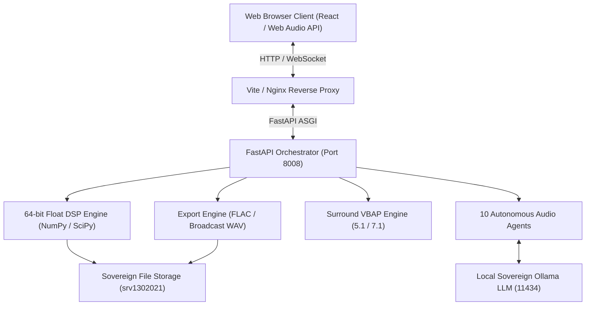

# SONIQ AI: SYSTEM ARCHITECTURE SPECIFICATION

## 1. System Overview
SONIQ AI is a modular, professional-grade Autonomous Audio Production and Surround Sound Engineering Platform. It combines a low-latency Web Audio API / AudioWorklet browser environment with a 64-bit floating point Python DSP backend, 10 autonomous AI audio engineering agents, and a multi-channel spatialization engine.

## 2. Core Engine Subsystems
1. **Browser Audio Engine (A)**:
   - High-performance Web Audio API graph (`AudioContext`, `GainNode`, `StereoPannerNode`, `AnalyserNode`).
   - Browser microphone capture via `MediaDevices.getUserMedia` and `MediaRecorder`.
   - Real-time 60fps RTA spectrum and peak/RMS metering.

2. **Server-Side Audio Processing Engine (B)**:
   - Non-destructive 64-bit floating point audio manipulation.
   - Exact sample rate (44.1 kHz - 192 kHz), bit-depth (16, 24, 32f), and channel allocation tracking.
   - ITU-R BS.1770-4 gated loudness measurement, LRA, and 4x oversampling True-Peak computation.

3. **AI Audio Intelligence Multi-Agent System (C)**:
   - 10 autonomous agents with specialized responsibilities, memory, tools, and execution history.
   - Production Manager (Agent 10) orchestrating multi-agent pipelines from natural language prompts.
   - Local sovereign Ollama LLM execution with deterministic acoustic rule engine fallbacks.

4. **Native DSP & Plugin Engine (D)**:
   - Robert Bristow-Johnson Audio EQ Cookbook Biquad filter engine.
   - Linkwitz-Riley 4th order crossovers (24 dB/oct).
   - Optical and VCA style dynamic compressors with soft-knee.
   - Zero-overshoot lookahead brickwall peak limiter.
   - Algorithmic Schroeder/Moorer diffusion reverb.
   - Asymmetric tube and hyperbolic tangent tape saturation.

5. **Audio Export and Delivery Engine (E)**:
   - Lossless FLAC (16/24-bit, up to 192 kHz).
   - Broadcast WAV PCM (BWF metadata, 24/32-bit float).
   - Multichannel 5.1 and 7.1 SMPTE audio files.
   - Technical QC Delivery Certificates with SHA256 checksums and acoustic audit verification.
